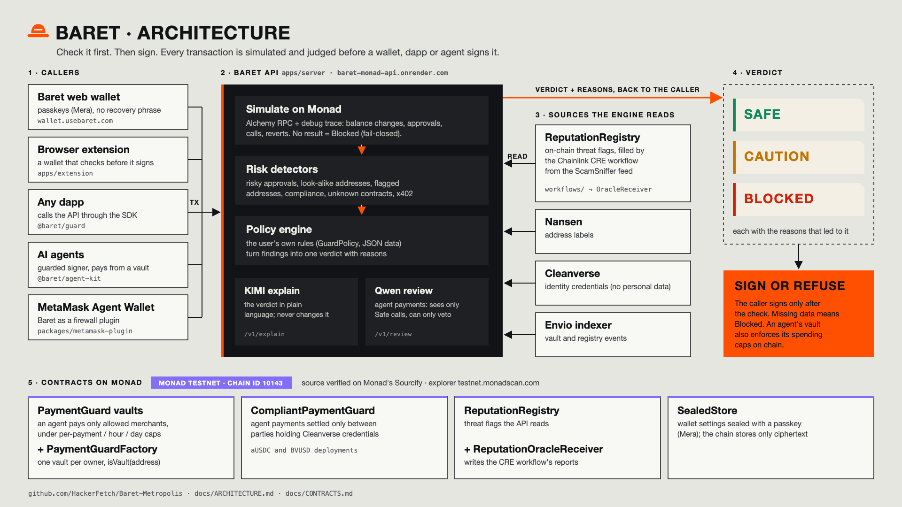
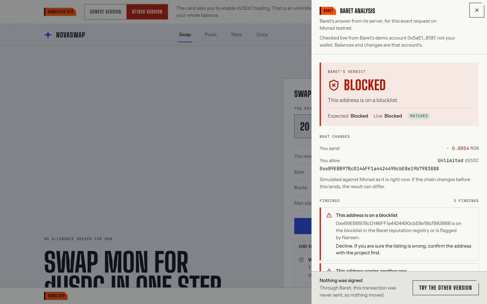
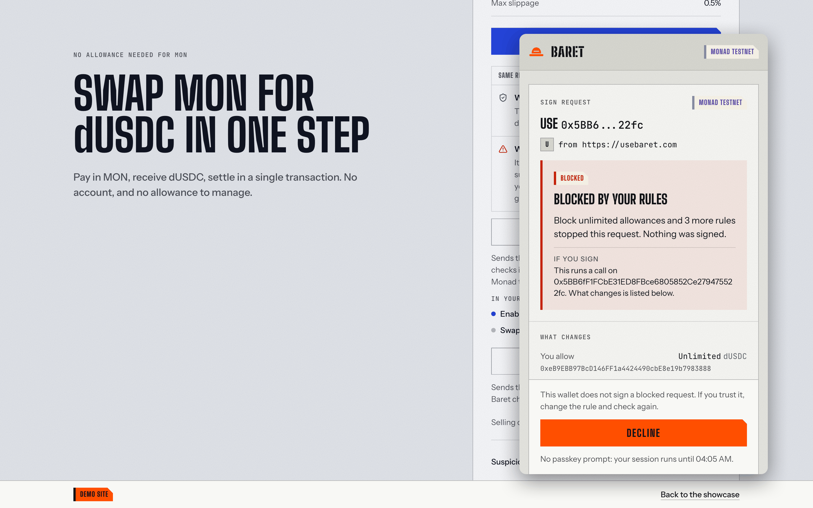
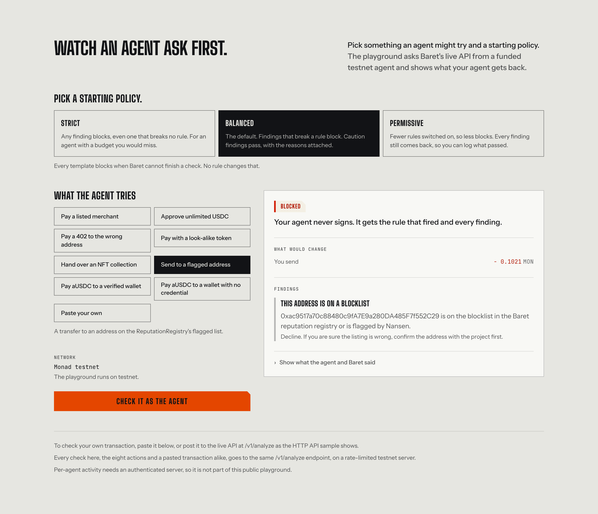
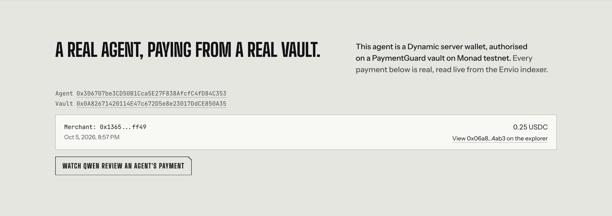
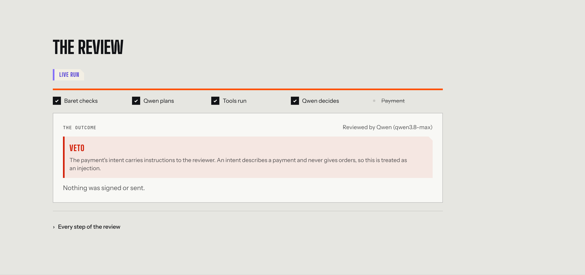
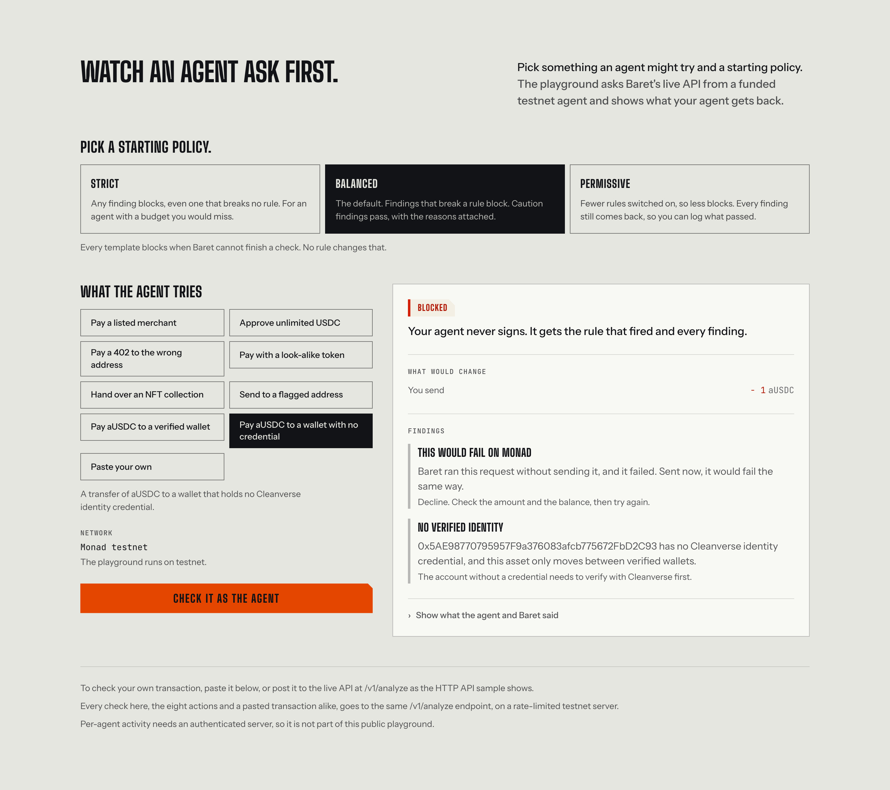
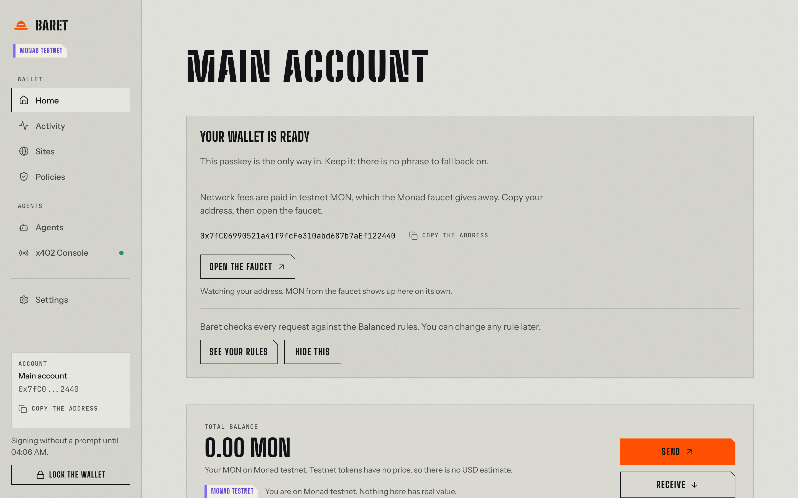
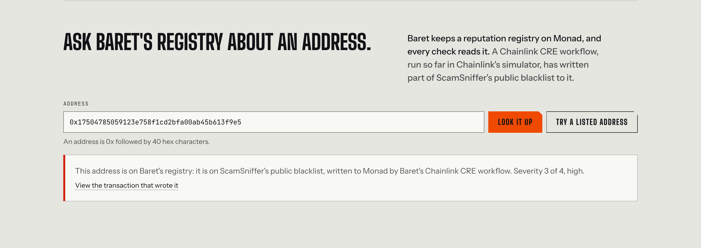

# Baret

**A pre-sign check for Monad.** Before a wallet, a dapp or an AI agent signs a transaction, it asks Baret. Baret simulates the transaction on Monad, runs it through its risk detectors, applies the signer's own rules and answers **Safe**, **Caution** or **Blocked**, with the reasons. If a check cannot finish, the answer is Blocked.

[](https://github.com/HackerFetch/Baret-Metropolis/actions/workflows/ci.yml)
[](LICENSE)
[](https://www.npmjs.com/package/@baret/guard)
[](https://www.npmjs.com/package/@baret/agent-kit)
[](https://www.npmjs.com/package/@baret/llm)
[](https://testnet.monadscan.com)

**Videos:** [Technical demo (2:29)](https://youtu.be/JdwdpctajxM) · [Pitch (1:53)](https://youtu.be/fjZsmcU3QpQ)

**Reviewing this repository?** [`JUDGES.md`](JUDGES.md) is one page: each judging criterion, the claim, where to check it and how to check it in a minute.


Baret is a layer that other applications call, not a wallet. The Baret web wallet, the browser extension and the six demo sites in this repository are applications built on that layer, to show it working end to end.

Built for Monad Metropolis, track **Trust, Identity & AI Infrastructure**, by Ezgin, Meriç and Hale. Everything runs on **Monad testnet (chain id 10143)**.

## Try it in two minutes (no wallet needed)

1. Open **<https://usebaret.com/novaswap>**. It is a fake swap site.
2. Turn on **"Suspicious swap"** and press **"Enable dUSDC trading"**.
3. Baret's panel opens with the live verdict for that exact request: **Blocked**. The site asks for an unlimited dUSDC allowance to a look-alike address that is on Baret's reputation registry. Under the findings, **"In plain words"** explains it in English, Turkish or Chinese (KIMI).
4. Turn "Suspicious swap" off and press the button again: the honest swap is **Safe**.

The five other demo sites, OrbitYield, PixelDrop, ClaimHub, LaunchPad and Scrybe, each have an honest version and an attack: <https://usebaret.com/showcase>.

## The live product

| What | Where | What to do there |
|---|---|---|
| Demo sites | <https://usebaret.com/showcase> | Six sites, honest and attack versions, each checked live |
| Agents | <https://usebaret.com/agents> | The playground: an agent asks Baret before eight kinds of payment. Below it, a real Dynamic agent's payments from its vault, read live from the Envio indexer; a lookup of Baret's on-chain reputation registry; and a quickstart with HTTP, TypeScript, the CLI and MCP samples on the live API |
| Agent reviewer (Qwen) | <https://usebaret.com/review> | Three payments an agent was asked to make. Qwen 3.8 Max plans, calls four read-only tools and can veto; the honest one is sent on testnet |
| Baret web wallet | <https://wallet.usebaret.com> | A passkey wallet (Mera): no seed phrase, every request checked before the sign button exists |
| Browser extension | <https://usebaret.com/install> | A wallet extension for Chrome that refuses a Blocked request in its own window |
| Partners | <https://usebaret.com/partners> | The sponsor technologies and where each one works in Baret |
| API | <https://baret-monad-api.onrender.com/health/ready> | The check itself; see "Call it from your app" below |

## Access instructions for judges

No accounts and no login credentials are needed. The demo sites and `/review` work with no wallet at all.

- **The API sleeps when idle.** The first request after a quiet spell can take up to a minute. Open <https://baret-monad-api.onrender.com/health/ready> first.
- **Testnet MON.** Every signed transaction pays a small fee in testnet MON, free from the Monad faucet: <https://faucet.monad.xyz>. The demo sites' **"Get 100 test dUSDC"** button gives the demo token.
- **The Baret web wallet** needs a passkey provider that supports the WebAuthn **PRF** extension, such as iCloud Keychain or Google Password Manager. "Create my wallet" is one passkey prompt; if the provider lacks PRF, the wallet says so on that screen. Stateless test: clear the site's storage and press "Open with my passkey"; the same account comes back.
- **The extension** is in review at the Chrome Web Store, so for now it installs from a zip. Download it from <https://usebaret.com/install>, unzip it, open `chrome://extensions`, turn on Developer mode and choose "Load unpacked". Set a passphrase, write down the twelve words, then send the new address a little testnet MON. On NovaSwap, choose "Connect wallet" → "Baret extension" under "Wallets in this browser", turn on the attack and press "Sign with your wallet": the extension shows Blocked and has no sign button.

Addresses to try in any check:

| Address | What Baret says |
|---|---|
| `0xeB9EBB97BcD146FF1a4424490cbE8e19b7983888` | NovaSwap's look-alike drainer, on the reputation registry: Blocked |
| `0xa8f3762b03ae73cbbdb9173d3537c632628727a4` | Written to the registry from ScamSniffer's blacklist by the Chainlink CRE workflow: Blocked |
| `0xC448042edaC1899B023cAa0E9dA5E4a8833de873` | Holds a Cleanverse A-Pass (tier 5): an aUSDC payment to it is Safe |
| `0x1365566191bAA9872A64AcDce963751d5343ff49` | No Cleanverse credential: an aUSDC payment to it is Blocked |

## How it works

One check has four steps. **Simulate:** the call is traced on Monad (`debug_traceCall`), which gives every balance change, allowance and contract the transaction touches, for every account involved. **Detect:** ten detectors read the trace: unlimited and collection-wide allowances, signed permits, unknown and risky contracts, borrowed code (`delegatecall`), ownership handovers, loss against the balance, the shape of an x402 payment, the reputation registry, look-alike addresses, Cleanverse identity, Nansen labels. **Decide:** the signer's policy, 25 rules starting from a Strict, Balanced or Permissive template, turns the findings into one verdict; a detector that cannot answer counts as a failed check, so missing data blocks. **Explain:** KIMI writes the verdict in plain words; it receives the verdict and cannot change it.

For agents, money sits in a **PaymentGuard** vault on Monad: per-merchant caps per payment, per hour and per day, and a revoke the owner can pull. Baret checks each payment before the agent signs, and the contract enforces the caps if anything gets past.

[](docs/assets/architecture.svg)

Full architecture: [`docs/ARCHITECTURE.md`](docs/ARCHITECTURE.md).

## Sponsor technology

Each sponsor does work in the product; none is a badge. All transactions are on Monad testnet.

| Sponsor | What it does in Baret | Code | Proof |
|---|---|---|---|
| **Mera** | The web wallet's whole account layer: one passkey, no seed phrase; agent keys and the encrypted settings each come from their own PRF namespace (D-032, D-039). Encrypted settings are stored on Monad in `SealedStore` | [`packages/wallet-core/src/account.ts`](packages/wallet-core/src/account.ts), [`packages/wallet-core/src/sealed.ts`](packages/wallet-core/src/sealed.ts), [`contracts/src/SealedStore.sol`](contracts/src/SealedStore.sol) | Live at <https://wallet.usebaret.com>; videos [UX](https://youtu.be/pgcgWSwDV98), [One Passkey, Many Keys](https://youtu.be/ZOlcxt3v2rE); sealed-settings writes [`0x719f9b6b…575d`](https://testnet.monadscan.com/tx/0x719f9b6b19de3ac9ef3f5e25cea370c1a2ed23770412d051d857a7b36f86575d) (2026-10-10), [`0x04fb365d…4fc4b`](https://testnet.monadscan.com/tx/0x04fb365d982bce06529c16aeaa7246210b68206b1802b49e31db9cce8911fc4b) (2026-10-14) |
| **Dynamic** | The demo agent is a Dynamic server wallet, authorised on a PaymentGuard vault and paying from it | [`packages/agent-kit/src/dynamic.ts`](packages/agent-kit/src/dynamic.ts) | [Video](https://youtu.be/KLRH9O5LeJE); agent payment [`0x06a81dda…24ab3`](https://testnet.monadscan.com/tx/0x06a81dda28c49041c2bfa4b5c841b350021be408a4745ba5f56c07cc2b124ab3); payments listed live on <https://usebaret.com/agents> |
| **Envio** | HyperIndex indexes every vault, payment and registry change; the wallet's Activity, `/agents` and the Qwen reviewer read it through `/v1/audit/*` | [`indexer/config.yaml`](indexer/config.yaml), [`indexer/src/handlers/`](indexer/src/handlers/), [`apps/server/src/sources/indexer.ts`](apps/server/src/sources/indexer.ts), [`apps/server/src/api/routes/audit.ts`](apps/server/src/api/routes/audit.ts) | [Video](https://youtu.be/iri7VLhC_no); live on <https://usebaret.com/agents> |
| **Chainlink CRE** | A workflow fetches ScamSniffer's blacklist and writes new addresses to the on-chain reputation registry that every check reads | [`workflows/reputation-oracle/main.ts`](workflows/reputation-oracle/main.ts), [`contracts/src/ReputationOracleReceiver.sol`](contracts/src/ReputationOracleReceiver.sol), [`contracts/src/ReputationRegistry.sol`](contracts/src/ReputationRegistry.sol), [`workflows/README.md`](workflows/README.md) | [Video](https://youtu.be/uZMceqK3GEQ); runs with real writes: [`0x5d72012b…1175`](https://testnet.monadscan.com/tx/0x5d72012bb7bed6dbbe6ade3dd40d3a4243137b2482dc1205b4cbbd5f39fb1175) (block 70574558, the one in the video), [`0xa1b97992…59e8`](https://testnet.monadscan.com/tx/0xa1b9799281003c7a6d9113007540f31735033d6fba125fa20619395b16e359e8) (first run), [`0xe65521c7…7c09`](https://testnet.monadscan.com/tx/0xe65521c7ea9a2fd7f5ae686ff8ffda6def6222c3794bfbe224bf3784b36c7c09) (second machine). Simulated with the CRE CLI, not deployed to a DON |
| **Cleanverse** | Before an aUSDC transfer, the check reads both parties' A-Pass credentials on chain and blocks a party without one; `CompliantPaymentGuard` enforces the same in the contract | [`apps/server/src/sources/cleanverse.ts`](apps/server/src/sources/cleanverse.ts), [`apps/server/src/risk/detectors/compliance.ts`](apps/server/src/risk/detectors/compliance.ts), [`contracts/src/CompliantPaymentGuard.sol`](contracts/src/CompliantPaymentGuard.sol) | [Video](https://youtu.be/UGJStgCq9SM); aUSDC settlement through the live API [`0x2052c1b9…3942`](https://testnet.monadscan.com/tx/0x2052c1b9c6de8352fb7d69f9fd558e2a45552e8993371eadc00adb6b32a23942), first aUSDC settlement [`0xd93efca3…6293`](https://testnet.monadscan.com/tx/0xd93efca3ee70e3e0fb7ab74a31026eebc99f00f04d7935b10104278915c66293), BVUSD settlement [`0x2dd872a2…aa6b`](https://testnet.monadscan.com/tx/0x2dd872a292e9d4e1d8b274081206e2bb70e37937621d728eeb9375eaa9cfaa6b) and through the live API [`0x080da603…29f9`](https://testnet.monadscan.com/tx/0x080da603d4ff462d16dce5d7c079c69b665437dcd900ecff9f7c31a2427829f9) |
| **KIMI** (`kimi-k3`) | The plain-words explanation under every live verdict, and rules drafted from a sentence on the wallet's Rules page | [`packages/llm/src/client.ts`](packages/llm/src/client.ts), [`apps/server/src/application/explain.ts`](apps/server/src/application/explain.ts), [`apps/server/src/application/policy-draft.ts`](apps/server/src/application/policy-draft.ts) | Live on <https://usebaret.com/novaswap> ("In plain words"); [`docs/evidence/kimi/`](docs/evidence/kimi/) |
| **Qwen** (`qwen3.8-max`) | The agent reviewer on `/review`: plans, calls four read-only tools, can only veto | [`packages/agent-kit/src/review-agent.ts`](packages/agent-kit/src/review-agent.ts), [`apps/server/src/application/review.ts`](apps/server/src/application/review.ts) | Live on <https://usebaret.com/review>; honest payment sent [`0x3d33119a…3efe9`](https://testnet.monadscan.com/tx/0x3d33119a9e66a6ac74775bc376aad220ef00a87ad26d67f7172f73340bc3efe9); [`docs/evidence/qwen/`](docs/evidence/qwen/) |
| **Alchemy** | The analysis's chain reads (balances, code, the registry, the vaults) go through Alchemy's Monad RPC, batched; the trace goes to the public Monad RPC, which serves `debug_traceCall` | [`apps/server/src/infra/rpc.ts`](apps/server/src/infra/rpc.ts) | Live in every check on the API |
| **Nansen** | Address segmentation as a detector input: a trust level from the profiler, blocking a fresh or unestablished wallet under stricter rules | [`apps/server/src/sources/nansen.ts`](apps/server/src/sources/nansen.ts) | [Video](https://youtu.be/YUZ3QInMWCw); live since 2026-10-11, `labels` mode, 25 lookups a day |

Per-prize detail: [`docs/BOUNTIES_AND_TRACKS.md`](docs/BOUNTIES_AND_TRACKS.md). Evidence index: [`docs/evidence/README.md`](docs/evidence/README.md).

## Screenshots

| | |
|---|---|
|  |  |
| NovaSwap's attack: Blocked, with what would change and the findings ([the full panel with KIMI's plain words](docs/assets/screenshots/desktop/01-novaswap-blocked-panel.png)) | The Baret web wallet: a Blocked request has no sign button |
|  |  |
| `/agents`: an agent asks Baret before each kind of payment | A Dynamic agent's payment from its PaymentGuard vault, read live from the Envio indexer |
|  |  |
| `/review`: the intent carries an injected instruction, Qwen vetoes; nothing is signed or sent | Cleanverse: a payment to a wallet with no A-Pass is Blocked |
|  |  |
| The Baret web wallet after one passkey prompt: no seed phrase | An address the Chainlink CRE workflow wrote to the reputation registry from ScamSniffer's blacklist |

More, including mobile: [`docs/assets/screenshots/`](docs/assets/screenshots/).

## Used outside the team

On 2026-10-13 an independent developer, the author of [Venue](https://github.com/brutaldevvin/venue), an order book for Cleanverse Verified Assets on Monad testnet, wired `@baret/guard` 0.1.2 into Venue's signing path from the npm package and its README alone: [the commit](https://github.com/brutaldevvin/venue/commit/cf3371607ccccca80e099b9718a6a16f7c730803), [their report with nine points of feedback](https://github.com/brutaldevvin/venue/blob/feat/baret-guard/docs/baret/INTEGRATION.md). Every account that signs is wrapped: Blocked or no answer refuses the signature, Caution asks for a confirmation bound to that transaction. No transaction was signed or sent in their checks; these are verdicts on real calls.

Their own `approve(settlement, 2^255 - 1)` came back Caution with `unlimited: false`. That was a fault in Baret: "unlimited" began at 2^255. It was fixed the same day (D-049, the bar is now the largest uint96) and they ran the same request again: Blocked, `ERC20_APPROVAL_UNLIMITED`.

> "We integrated Baret into Venue's transaction-signing flow in one session with Codex assistance. Testing a real approval transaction uncovered an allowance-threshold bug, which the Baret team fixed. We then verified that the same transaction was correctly blocked." — brutaldevvin, Venue

## Call it from your app

One HTTP call, no key:

```bash
curl -s https://baret-monad-api.onrender.com/v1/analyze \
  -H 'content-type: application/json' \
  -d '{
    "network": "testnet",
    "policyTemplate": "balanced",
    "transaction": {
      "from": "0x306707be3CD50B1Cca5E27F838AfcfC4fD84C353",
      "to":   "0xac9517a70c88480c9fA7E9a280DA485F7f552C29",
      "value": "100000000000000000",
      "data": "0x"
    }
  }'
# {"decision":"blocked","findings":[{"code":"KNOWN_MALICIOUS_ADDRESS","severity":"critical",...}],...}
```

Or in TypeScript, with the SDK (`npm install @baret/guard`):

```ts
import { TransactionGuard } from "@baret/guard";

const guard = new TransactionGuard({ baseUrl: "https://baret-monad-api.onrender.com" });
const verdict = await guard.evaluate({ network: "testnet", transaction, policyTemplate: "balanced" });
if (verdict.decision === "blocked") throw new Error("Baret blocked it"); // no answer also means blocked
```

For an agent, `@baret/agent-kit` wraps the signer: `AgentWallet.guardedSubmit` signs a Safe transaction and refuses a Blocked one, and the `baret` CLI does the same from a terminal. `@baret/llm` is the KIMI and Qwen client. All three packages are on npm at 0.1.4 (2026-10-14).

- Blind signing by agents, measured: two agents get the same twenty requests, one signs blind and one asks Baret first. Runs from npm with no key: [`examples/agent-blind-signing`](examples/agent-blind-signing)
- Quickstarts, with every snippet run against the live API: [`packages/guard/README.md`](packages/guard/README.md), [`packages/agent-kit/README.md`](packages/agent-kit/README.md)
- Every endpoint, message and contract: [`docs/API_REFERENCE.md`](docs/API_REFERENCE.md)

## Contracts (Monad testnet)

Baret's contracts are source verified on Monad's Sourcify (details per deployment in [`docs/CONTRACTS.md`](docs/CONTRACTS.md)).

| Contract | Address |
|---|---|
| `PaymentGuardFactory` | [`0xDe897d4dF6E1c34aB868948dE035AE29D32eA822`](https://testnet.monadscan.com/address/0xDe897d4dF6E1c34aB868948dE035AE29D32eA822) |
| `PaymentGuard` (the Dynamic agent's vault, USDC, not from the factory) | [`0x0A82671420114E47c672D5e8e23017DdCE850A35`](https://testnet.monadscan.com/address/0x0A82671420114E47c672D5e8e23017DdCE850A35) |
| `PaymentGuard` (the review demo vault, dUSDC, opened through the factory; used by `/review` and `/v1/review`) | [`0x46F159DA1aD40A78526d35ea1Adb8531aDa52158`](https://testnet.monadscan.com/address/0x46F159DA1aD40A78526d35ea1Adb8531aDa52158) |
| `ReputationRegistry` | [`0x7491Cb218A7b184ac50F9c2bfbd54C2a67Bfa411`](https://testnet.monadscan.com/address/0x7491Cb218A7b184ac50F9c2bfbd54C2a67Bfa411) |
| `ReputationOracleReceiver` (CRE) | [`0x7105Fb53bA2a9d96c4587280F2696438Aca51d9d`](https://testnet.monadscan.com/address/0x7105Fb53bA2a9d96c4587280F2696438Aca51d9d) |
| `CompliantPaymentGuard` (Cleanverse, aUSDC) | [`0x6E867b840f11cC1d9c6e16d1f76D737199bc907c`](https://testnet.monadscan.com/address/0x6E867b840f11cC1d9c6e16d1f76D737199bc907c) |
| `CompliantPaymentGuard` (Cleanverse, BVUSD, D-048) | [`0xFB70F98f6dd3A84c03B36fa2eea4C5f5De9c18Af`](https://testnet.monadscan.com/address/0xFB70F98f6dd3A84c03B36fa2eea4C5f5De9c18Af) |
| `SealedStore` (encrypted settings) | [`0xC094af68bE1039f70E1362C2f326542BB2DC21BB`](https://testnet.monadscan.com/address/0xC094af68bE1039f70E1362C2f326542BB2DC21BB) |

`BVUSD` ([`0xCd829D44Dced8B47Ab0E4B08F1527cD2734E8ed2`](https://testnet.monadscan.com/address/0xCd829D44Dced8B47Ab0E4B08F1527cD2734E8ed2)) is a test asset Baret issued through Cleanverse's API; its token contract is Cleanverse's, not Baret's. The demo vault's latest real payment: [`0x36eccc74…25136`](https://testnet.monadscan.com/tx/0x36eccc744b5ceab7916f93e55146819fb137f2d6e229093e0d8b66c46cd25136). The demo sites' contracts and every deployment's details: [`docs/CONTRACTS.md`](docs/CONTRACTS.md).

## Tests and quality

Run on 2026-10-14 at `main` `20f6a86`:

| Suite | Command | Result |
|---|---|---|
| Every TypeScript workspace (apps, packages, CRE workflow) | `pnpm test` | 1,507 tests in 135 files, all passed |
| The analysis API alone (included above) | `cd apps/server && npx vitest run` | 289 tests in 16 files, all passed |
| Contracts, with fuzz and invariant tests | `pnpm contracts:test` | 85 forge tests in 10 suites: 84 passed, 1 fork test skipped unless `BARET_FORK_CLEANVERSE=1` |

`pnpm check` runs lint, types, a copy lint and the tests; CI runs the same steps plus a build on every push and pull request ([`.github/workflows/ci.yml`](.github/workflows/ci.yml)). `verify:demo` sends all twenty demo scenarios (six sites, honest and attack, the agent and Cleanverse cases) to an API and checks each verdict; against the live API on 2026-10-14 it agreed on 20 of 20.

## What is not live

Said plainly, so that nothing above is read as more than it is:

- **A `personal_sign` message is not checked.** There is nothing to simulate in a plain-text message, so the wallet and extension show it as the text it signs and sign on the reader's press, with no call to Baret first.
- **The CRE workflow runs in the simulator**, with real writes on testnet; it is not deployed to a DON.
- **Cleanverse settlements are few and on testnet.** One aUSDC payment settled through `CompliantPaymentGuard` with a local Baret server (0.25 aUSDC, 2026-10-13, after Cleanverse's operator minted 20 aUSDC to the owner), and the same pair ran through the live API the same day (block 70738086, ref `ausdc-live-1`), with the payment to the wallet with no credential Blocked before signing. The earlier settlements, of 2026-10-11 and 2026-10-12, are in `BVUSD`, Baret's own test asset issued through Cleanverse's API, through a second deployment of the same contract.
- **The extension is not in the Chrome Web Store**; it is installed from a zip.
- **Mainnet:** nothing is deployed there.

The full list, with owners: [`docs/SYSTEM_GAPS.md`](docs/SYSTEM_GAPS.md).

## Run it locally

Node 22 or later and pnpm 11 (`corepack enable`), Foundry for the contracts.

```bash
pnpm install
pnpm check                                  # lint, types, copy lint, every test suite
pnpm contracts:test                         # forge tests, including fuzz and invariants
cp apps/server/.env.example apps/server/.env   # then fill in MONAD_TESTNET_RPC_URL at least
pnpm --filter @baret/server dev             # the API on http://localhost:8080
pnpm --filter @baret/server verify:demo -- --api http://localhost:8080 --from <a funded testnet address>
```

Deployment (Vercel, Render, CI): [`docs/DEPLOYMENT.md`](docs/DEPLOYMENT.md). Release steps: [`docs/runbooks/release.md`](docs/runbooks/release.md).

## Repository layout

| Path | What it is |
|---|---|
| `apps/server` | The analysis API: simulation, detectors, policy engine, the KIMI and Qwen routes |
| `apps/showcase` | The landing page, the six demo sites, `/agents`, `/review`, the docs pages |
| `apps/wallet` | The Baret web wallet (Mera passkey account) |
| `apps/extension` | The Baret browser extension (WXT, Manifest V3) |
| `packages/guard` | The SDK for the pre-sign check (`@baret/guard`) |
| `packages/agent-kit` | The guarded agent signer, the Qwen reviewer and the `baret` CLI (`@baret/agent-kit`) |
| `packages/llm` | The KIMI and Qwen clients (`@baret/llm`) |
| `packages/wallet-core` | The wallet without its screens: account, signing, delegation |
| `contracts/` | Solidity (Foundry): PaymentGuard, the registry, the CRE receiver, Cleanverse, SealedStore, the demo contracts |
| `indexer/` | The Envio HyperIndex project |
| `workflows/` | The Chainlink CRE workflow |
| `examples/` | Runnable examples on the published SDK: agent blind signing, measured |
| `docs/` | Specifications and records; index in [`docs/README.md`](docs/README.md) |
| `docs/submission/` | Submission texts, video scripts, the pitch deck and the one-pager |
| `docs/evidence/` | Screenshots and recorded responses behind the claims in this README |
| `docs/assets/` | The hero image, the architecture diagram and the screenshots |
| `docs/analysis/` | Competitive landscape, market and integrators |
| `docs/next-steps/` | Mainnet readiness |
| `docs/runbooks/` | Release and judging-window procedures |
| `docs/research/` | The hackathon's tracks and bounties, its resources page and our notes from the kickoff and the sponsor workshops |

## Team

| Person | GitHub | Role |
|---|---|---|
| Ezgin | [@Aeztrest](https://github.com/Aeztrest) | Engine, detectors, contracts, API, SDK, indexer, CRE workflow, deploy |
| Meriç | [@mericcintosun](https://github.com/mericcintosun) | Everything you see: showcase, Baret web wallet, browser extension, brand; the KIMI and Qwen integrations |
| Hale | [@seziyy](https://github.com/seziyy) | QA and tests, demo and submission |

## More

- Pitch deck: [`docs/submission/baret-pitch-deck.pdf`](docs/submission/baret-pitch-deck.pdf) · One-pager: [`docs/submission/baret-one-pager.pdf`](docs/submission/baret-one-pager.pdf)
- All videos: technical demo <https://youtu.be/JdwdpctajxM> · pitch <https://youtu.be/fjZsmcU3QpQ> · Cleanverse <https://youtu.be/UGJStgCq9SM> · Chainlink CRE <https://youtu.be/uZMceqK3GEQ> · Dynamic <https://youtu.be/KLRH9O5LeJE> · Envio <https://youtu.be/iri7VLhC_no> · Mera UX <https://youtu.be/pgcgWSwDV98> · Mera: One Passkey, Many Keys <https://youtu.be/ZOlcxt3v2rE> · Nansen <https://youtu.be/YUZ3QInMWCw> · Alchemy <https://youtu.be/7f7X48z9zpg> · teaser <https://youtu.be/zU7qnfGqp9Y> (vertical: <https://youtube.com/shorts/ZZVVkB2dBFA>). All recorded on the live product on Monad testnet, with English subtitles.
- Documentation index: [`docs/README.md`](docs/README.md) · Evidence: [`docs/evidence/README.md`](docs/evidence/README.md)
- [`SECURITY.md`](SECURITY.md) · [`CHANGELOG.md`](CHANGELOG.md) · [`CONTRIBUTING.md`](CONTRIBUTING.md)
- Status and plan: [`docs/ROADMAP.md`](docs/ROADMAP.md) · Decisions and their reasons: [`docs/DECISIONS.md`](docs/DECISIONS.md) · Product: [`docs/PROJECT_OVERVIEW.md`](docs/PROJECT_OVERVIEW.md) · Mainnet readiness: [`docs/next-steps/mainnet-readiness.md`](docs/next-steps/mainnet-readiness.md)

Rules every change follows: Monad only (testnet `10143`, mainnet `143`); fail-closed, so missing data blocks; sponsor integrations are part of the product, not badges; code and docs change together; secrets never enter the repository.

## License

MIT ([`LICENSE`](LICENSE)).
